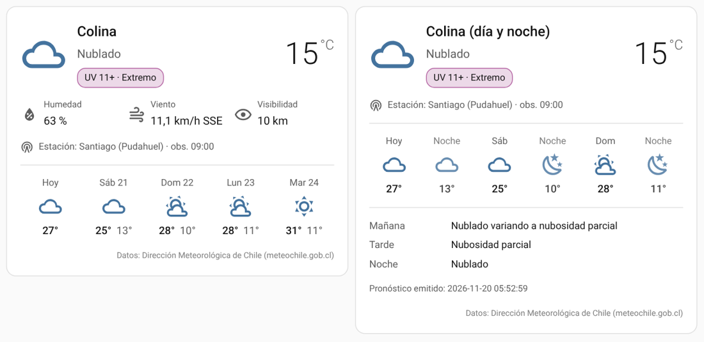
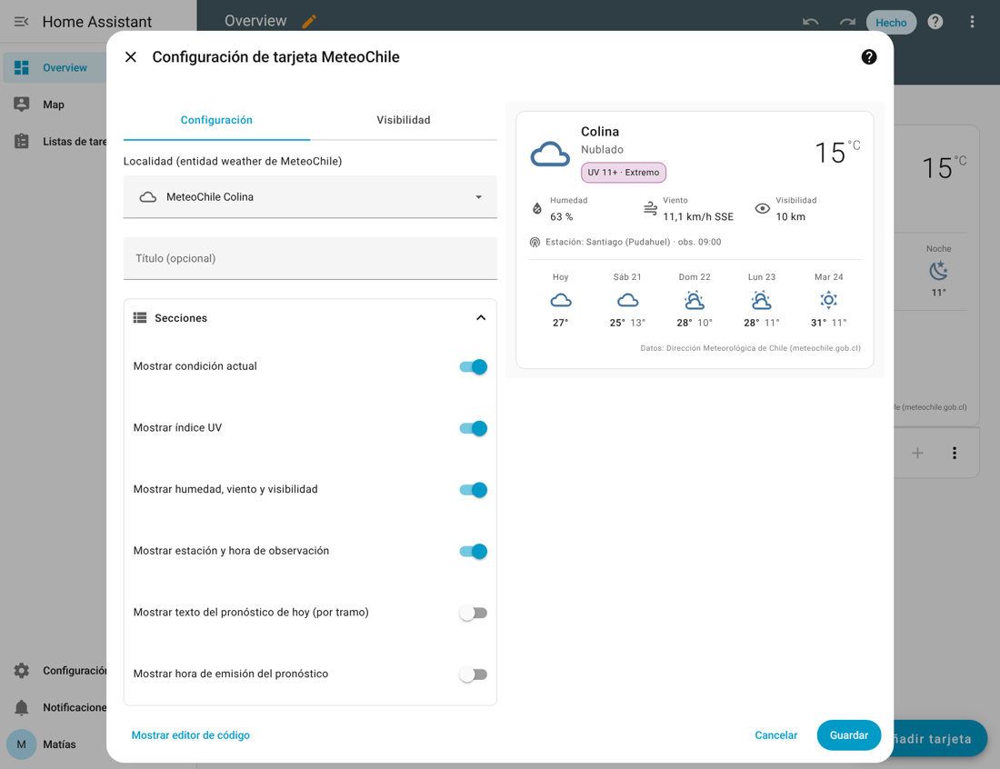

# MeteoChile (DMC) para Home Assistant

Integración no oficial que crea una entidad `weather` con la condición actual y el pronóstico a 5 días que publica la **Dirección Meteorológica de Chile** en [meteochile.gob.cl](https://www.meteochile.gob.cl/).

## Qué entrega

| Dato | Fuente |
|---|---|
| Pronóstico diario (máx/mín y condición, 5 días) | `pronostico.js` de la DMC, por localidad |
| Pronóstico día/noche (`twice_daily`) | El mismo archivo (tramos mañana/tarde y noche) |
| Temperatura, humedad, viento, visibilidad y condición actual | `condicionactual.js`: observación horaria de la estación (aeródromo) que elijas |
| Índice UV | `pronostico_radiacion_uv.js`, por localidad |

Atributos extra: texto del pronóstico de hoy por tramo (madrugada, mañana, tarde, noche), hora de redacción del pronóstico, estación usada y hora de la observación.

## Instalación con HACS

1. En HACS → menú ⋮ → **Repositorios personalizados**.
2. Pega `https://github.com/matisaul/meteochile-ha` y elige la categoría **Integración**.
3. Busca **MeteoChile (DMC)**, instálala y reinicia Home Assistant.
4. Ajustes → Dispositivos y servicios → **Agregar integración** → MeteoChile (DMC).

### Instalación manual

Copia `custom_components/meteochile` a la carpeta `config/custom_components/` de Home Assistant y reinicia.

## Configuración

1. **Región**
2. **Localidad**: las localidades con pronóstico de la DMC en esa región. Por ejemplo, la Región Metropolitana tiene Colina, Santiago Centro/Norte/Oriente/Sur/Poniente, Curacaví, Melipilla y San José de Maipo.
3. **Estación para la temperatura actual**: la DMC publica la observación actual solo para estaciones de aeródromo. Se sugiere la más cercana (para Colina, Pudahuel). Puedes elegir "Sin estación" o cambiarla después en **Opciones**.

Puedes agregar la integración varias veces, una por localidad.

## Tarjeta para el panel de control

La integración trae su propia tarjeta, **MeteoChile**. Se carga sola al instalar la integración, sin instalar nada más.



1. Abre un panel de control → lápiz (editar) → **Añadir tarjeta**.
2. Busca **MeteoChile**.
3. Elige la localidad y lo que quieres mostrar con el editor visual: condición actual, nombre de la localidad, descripción de la condición, índice UV, humedad/viento/visibilidad, estación, texto del pronóstico por tramo, tipo de pronóstico (diario o día y noche) y cantidad de días.



También se puede escribir en YAML:

```yaml
type: custom:meteochile-card
entity: weather.meteochile_colina
name: Colina            # opcional
forecast_type: daily    # daily | twice_daily
days: 5                 # 1 a 5
show_current: true
show_name: true         # nombre de la localidad
show_condition: true    # descripción de la condición ("Nublado")
show_uv: true
show_details: true      # humedad, viento, visibilidad
show_station: true
show_forecast: true
show_text: false        # texto del pronóstico de hoy por tramo
show_issued: false      # hora de emisión del pronóstico
```

### Acciones al tocar

Como en otras tarjetas de Home Assistant, puedes elegir qué pasa al **tocar**, **tocar dos veces** o **mantener pulsado**, por separado para el ícono y para el resto de la tarjeta. Las acciones disponibles son las estándar: más información, navegar, abrir URL, ejecutar una acción, asistente, etc.

```yaml
tap_action:               # tarjeta (por defecto: más información)
  action: more-info
hold_action:
  action: navigate
  navigation_path: /lovelace/clima
icon_tap_action:          # ícono (si no se define, usa las de la tarjeta)
  action: perform-action
  perform_action: script.turn_on
  target:
    entity_id: script.regar_jardin
```

Opciones: `tap_action`, `double_tap_action`, `hold_action`, `icon_tap_action`, `icon_double_tap_action`, `icon_hold_action`.

Si no ves la tarjeta después de actualizar, recarga el navegador sin caché (Ctrl+F5).

## Limitaciones

- La DMC **no tiene una API pública** para esto. La integración lee los mismos archivos `.js` que usa el sitio web. Si la DMC cambia su formato o sus rutas, la integración puede dejar de funcionar hasta que se actualice.
- El pronóstico es por **localidad de la DMC**, no por comuna exacta. Elige la localidad más cercana a tu comuna.
- La "temperatura actual" viene de la estación elegida, no de la localidad del pronóstico.
- No hay montos de precipitación, probabilidad de lluvia ni pronóstico por hora: la DMC no los publica en estos archivos.
- La condición actual se revisa cada 5 minutos: la DMC publica una observación por hora por estación (unos 12 minutos después de la hora), así que el dato nuevo aparece en Home Assistant poco después de publicado. El pronóstico se revisa cada 30 minutos; la DMC lo redacta una o dos veces al día.

## Publicar en HACS

- **Como repositorio personalizado** (lo más rápido): basta con agregar la URL en HACS; idealmente crea un *release* (por ejemplo `v0.1.0`).
- **En la lista por defecto de HACS**: además necesitas que la acción `Validar` pase (hassfest + HACS) y que el repositorio tenga descripción y *topics*. Después se envía un PR a [hacs/default](https://github.com/hacs/default).

### Logo

El logo va en `custom_components/meteochile/brand/` (`icon.png`, `logo.png` y sus versiones `@2x`). Home Assistant 2026.3 o superior lo muestra directamente. En versiones anteriores la integración funciona igual, pero sin logo.

## Desarrollo

```bash
python -m venv venv && . venv/bin/activate
pip install pytest-homeassistant-custom-component
pytest
```

---

Datos © Dirección Meteorológica de Chile. Este proyecto no está afiliado a la DMC.
